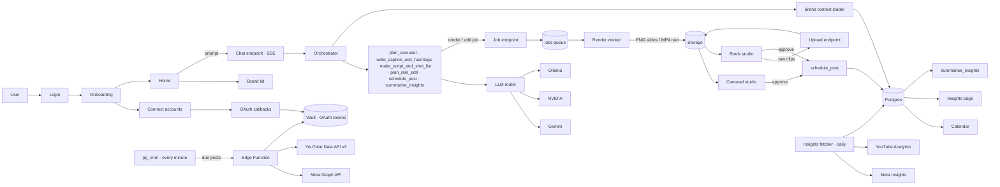

# Architecture

Source of truth: the [Snip FigJam board](https://www.figma.com/board/0CbxKNar5zw7kn4AByCZ6C/Snip). This page mirrors it so the repo stands on its own. If the two disagree, the board wins. Raise the difference rather than silently picking one.

## Nine layers

| #   | Layer         | What runs there                                                                                                                                                                          | Why                                                   |
| --- | ------------- | ---------------------------------------------------------------------------------------------------------------------------------------------------------------------------------------- | ----------------------------------------------------- |
| 1   | Client        | Browser. Users are small businesses and creators who are not developers.                                                                                                                 | —                                                     |
| 2   | Frontend      | Next.js App Router on Vercel (free tier): login, onboarding, connect accounts, home chat, brand kit, carousel studio, reels studio (Remotion timeline), calendar, insights, landing page | Fast React UI, free hosting, API routes built in      |
| 3   | Backend API   | Next.js API routes and Server Actions: SSE chat endpoint, OAuth callbacks, signed upload URLs, job creation                                                                              | One codebase, no separate server cost                 |
| 4   | Agent layer   | TypeScript orchestrator with tool calling (`packages/agent`)                                                                                                                             | One brain that delegates to small, focused tools      |
| 5   | LLM router    | OpenAI-compatible wrapper: Gemini, NVIDIA API Catalogue, optional Ollama                                                                                                                 | Switch models with one line; fall back on rate limits |
| 6   | Data          | Supabase: Auth, Postgres + RLS, Storage, Vault, jobs-table queue, pg_cron                                                                                                                | Auth, database, storage and cron in one free service  |
| 7   | Render worker | Python FastAPI (`apps/worker`) on a laptop or free Colab: Playwright, FFmpeg, whisper.cpp, librosa                                                                                       | Keeps heavy media work off Vercel                     |
| 8   | Publishing    | Supabase Edge Function → Meta Graph API, YouTube Data API v3                                                                                                                             | Official APIs, free, no scraping                      |
| 9   | Analytics     | Daily pg_cron job → Meta Insights API, YouTube Analytics API → `post_insights`                                                                                                           | Closes the loop so the agent learns what works        |

## Main flows

## Job queue

- The `jobs` table is the queue. Job kinds are `render_carousel`, `edit_reel`, `transcribe` and `publish`. Job statuses are `pending`, `running`, `done` and `failed`.
- Workers claim jobs with `SELECT … FOR UPDATE SKIP LOCKED` and set `locked_at`. Two workers never get the same job, and a job with an old `locked_at` can be claimed again.
- `publish` is handled by the Edge Function, triggered by pg_cron. The Python worker handles media jobs only.

## Data model

There are 17 tables: `users`, `businesses`, `brand_kits`, `social_accounts`, `conversations`, `messages`, `templates`, `posts`, `slides`, `reels`, `shots`, `clips`, `timeline_items`, `schedules`, `post_insights`, `jobs` and `assets`. The full ER diagram is on the board. The migrations in `supabase/migrations` (Phase 2) are the implementation. See [decisions.md](./decisions.md) for the places where the diagram needed interpreting.

## Platform limits we design around

- Meta publishing needs Instagram Business or Creator accounts, and app review for production. Development mode works with the developer's own accounts.
- Trending Instagram audio cannot be added through the API, so Snip uses royalty-free music.
- The YouTube Data API upload quota is small (each upload costs a lot of units), so uploads are queued and retried.
- The whole stack must run at ₹0 on free tiers, with an 8 GB RAM dev laptop.
